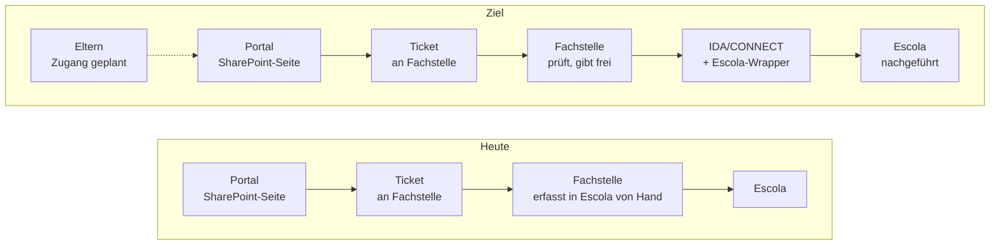
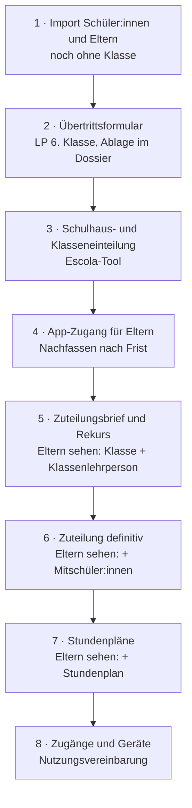
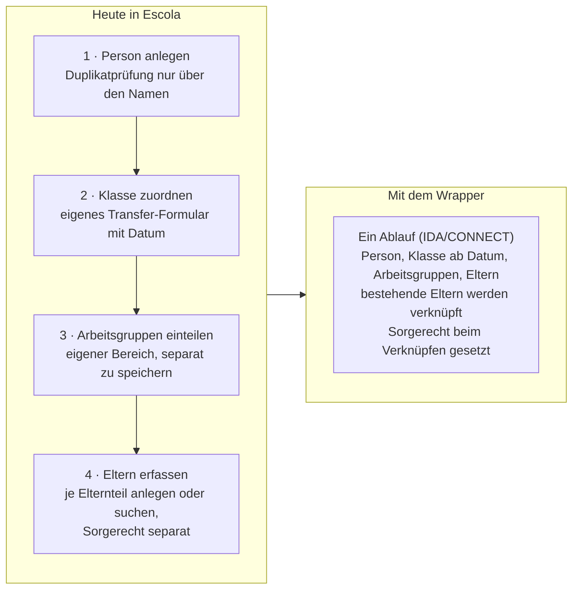

# Escola-Workflows: Aufwand heute und Automatisierung

Stand 15.11.2026 · Sek Bülach · Fassung zum Teilen mit Escola (Original als Dokument in claude.ai, diese Kopie im Repo)

## Zweck

Unser Ziel ist, dass Verwaltungsabläufe über ein Portal ausgelöst und der Escola-Teil danach automatisch erledigt wird. Dieses Dokument zeigt pro Ablauf, wo der Aufwand in Escola heute entsteht, was wir automatisieren und wo Escola selbst nachbessern könnte.

Heute lösen Mitarbeitende die Vorgänge über SharePoint-Seiten der Verwaltung aus (z. B. „Lernende anmelden“, „Kantonale Anstellung“). Daraus entsteht ein Ticket, und die zuständige Fachstelle erledigt den Escola-Teil von Hand. Einiges davon lässt sich auch direkt in Escola erfassen. Für Eltern steht das Portal noch nicht zur Verfügung; Änderungen melden sie heute über die Escola-App, sofern sie aktiviert ist.

Weil Escola keine offizielle API hat, haben wir einen Wrapper um die Weboberfläche gebaut. Er arbeitet mit einem persönlichen Login inkl. Zwei-Faktor und nutzt dieselben Aufrufe wie der Browser. Schreiben ist nur mit Freigabe möglich, Löschfunktionen wie „Personen definitiv löschen“ sind bewusst nicht eingebaut.

Die Abläufe WF-01 bis WF-20 haben wir mit den Fachstellen erhoben; nur ein Teil davon ist bereits im Wrapper umgesetzt. Live geprüft sind Login und Lesen, die Schreibabläufe testen wir schrittweise mit Testpersonen und einer Testklasse.

Portal und Ticket bleiben; was sich ändert, ist der Schritt nach der Freigabe durch die Fachstelle.

## Das Schuljahr vorbereiten

Als Nächstes nehmen wir die Zuteilung der Schüler:innen und den Kanal zu den Eltern in Angriff: Die Eltern sollen schon vor Schulstart in der Escola-App sein, und die Einteilung wird direkt dort ausgespielt. Was die Eltern sehen, wächst mit jeder Phase. Die Spalte „Anforderung an Escola“ beschreibt, was wir brauchen; ob Escola das bereits kann, wissen wir nicht in jedem Fall.

| Phase | Was passiert | Wer, welches System | Anforderung an Escola |
|---|---|---|---|
| 1 Import | Die Datenlieferung wird strukturiert eingelesen; unsere Anwendung sortiert, ergänzt fehlende Angaben, bildet Mailadressen und Zugangsdaten und erzeugt eine Standard-Importdatei. Die Schüler:innen haben noch keine Klasse. | unsere Anwendung, Escola-Import | Import, der alle gelieferten Angaben aufnimmt, auch Eltern und Sorgerecht |
| 2 Übertritt | Die Lehrpersonen der 6. Klassen reichen das Übertrittsformular ein; es liegt im Schülerdossier für Schulleitung, Zuteilende und später die Lehrpersonen. | Escola oder unsere Anwendung | Formular und Zugang für Lehrpersonen der abgebenden Schule |
| 3 Einteilung | Nach der Schulhauszuteilung teilt die Schulleitung die Schüler:innen in Klassen ein. | Escola-Tool | vorhanden |
| 4 App-Zugang | Spätestens jetzt erhalten die Eltern den App-Zugang; nach einer Frist fassen wir bei säumigen Eltern nach. Voraussetzung für den Zuteilungsbrief. | Escola-Funktion oder unsere App, notfalls Post Smart Send | Versand der Zugänge und Liste, wer noch nicht aktiviert hat |
| 5 Zuteilungsbrief | Brief per Escola; Eltern sehen nur Klasse und Klassenlehrperson. Rekurse über die App oder unsere Plattform. | Escola-App, unsere Plattform | Sichtbarkeit in der App pro Phase steuern; Rekurs in der App |
| 6 Definitiv | Nach Rekursfrist und Umteilungen gelten Klassen und Klassenlehrpersonen; Eltern sehen ggf. die Mitschüler:innen. | Escola | Sichtbarkeit Mitschüler:innen freischalten |
| 7 Stundenpläne | Der finale Stundenplan kommt als Export aus dem Stundenplaner nach Escola; ab dann sehen ihn die Eltern. | Stundenplaner, Escola | Import aus dem Stundenplaner |
| 8 Zugänge, Geräte | ICT lädt die Klassenlisten, erstellt fehlende Zugänge (Entra, Apple School Manager, weitere Umsysteme), meldet jedes Gerät einmal an und übergibt es mit Login-Blatt und Nutzungsvereinbarung. Die Vereinbarung geht per Escola an die Eltern und muss unterschrieben zurück, sonst bleibt das Gerät in der Schule. Gerätedaten gehen automatisch ins Inventar. | ICT, unsere Anwendung, Escola | Klassenlisten aus dem Escola-Dokumentensystem; Rücklauf der Unterschrift sichtbar (heute nicht möglich) |

Damit ist das Schuljahr vorbereitet.

## Das laufende Schuljahr

Absenzen, Verhaltenseinträge und Lernberichte sind in Escola vollständig gelöst. Lücken gibt es bei den Arztkontrollen und beim papierlosen Weg der Prüfungen zu den Eltern.

| Thema | Ablauf | System | Anforderung an Escola |
|---|---|---|---|
| Absenzen, Verhalten, Lernberichte | vollständig in Escola | Escola | keine |
| Arzt- und Zahnarztkontrolle | Gutscheine einmal jährlich bzw. einmal im Sekundarschulzyklus per Escola; die Rückmeldungen der Ärzt:innen nehmen wir auf unserer Plattform entgegen, legen sie automatisch im Dossier ab und markieren den Erhalt. Die Fachstelle braucht eine Liste, wer noch offen ist. | Escola, unsere Plattform | Kontrollen als Teil der Schülerdaten, Liste der offenen |
| Prüfungen an Eltern | Deckblätter tragen einen Schüler- und möglichst einen Prüfungscode. Nach der Korrektur werden sie gesammelt gescannt; unser System trennt und ordnet sie zu. Die Lehrperson kontrolliert die Zuordnung, dann gehen Prüfung und Note zur Bestätigung in die App. Das Visum kann geprüft werden, muss aber nicht. | unsere Plattform, Escola-App | Prüfung als Dokument mit der Note zustellen, Bestätigung durch die Eltern |
| Mutationen | über ein Formularsystem ausgelöst und in allen Systemen nachgeführt | Portal, unsere Plattform, Escola | siehe Abläufe WF-01 bis WF-10 |

## Ablage und Archiv in CMI

Das zentrale Dossier und das spätere Archiv führen wir in CMI; dort werden auch Anträge und Beschlüsse traktandiert und abgelegt. Solange Escola keine Schnittstelle zu CMI anbietet, überführen wir die Daten selbst:

- **Stammdaten:** Schüler:innen, Elternkontakte und Klassenzuteilung; die Schullaufbahn ergibt sich aus den Mutationen, die ebenfalls an CMI gehen.
- **Absenzen, Verhaltenseinträge, Prüfungsresultate:** als Einzeldatensätze, wenn die Schnittstellen es zulassen, bei Bedarf von uns umgewandelt; mindestens einmal am Ende des Schuljahrs als zusammenfassendes PDF über die Dokumentenschnittstelle.
- **Dokumente im Schülerdossier:** automatisch einmal täglich, mindestens zum Semesterende, insbesondere die Zeugnisse.
- **Schuljahresdossier:** alle Absenzen, Zeugnisse und Klassenlisten gesammelt als PDF, für die Auffindbarkeit und den Jahresbericht.

## Portal-Vorgänge und Stand im Wrapper

Von den Vorgängen auf unseren Portal-Seiten berühren die meisten Escola; die Ein- und Austritte sind im Wrapper bereits abgebildet. „Eingebaut“ heisst: im Wrapper vorhanden, noch nicht alles live getestet.

| Portal-Seite | Vorgang | Ablauf | Escola-Teil | Im Wrapper |
|---|---|---|---|---|
| Verwaltung Lernende | Lernende anmelden | WF-07 | Person, Klasse, Arbeitsgruppen, Eltern | eingebaut |
| Verwaltung Lernende | Lernende abmelden | WF-09 | Austritt, Eltern deaktivieren | eingebaut |
| Verwaltung Lernende | Einteilung | WF-08 | Klasse, Arbeitsgruppen | eingebaut |
| Verwaltung Lernende | Personenangaben | WF-10 | Felder und Adresse | eingebaut (Felder ändern) |
| Verwaltung Lernende | Zahnarzt- / Arztgutschein | – | fehlt in Escola: Kontrollen heute in CMI, in benutzerdefinierten Escola-Feldern oder in unserer Anwendung zu führen | nein |
| Verwaltung Lernende | Schulbestätigung, Zeugnis-Kopie, Dokument einreichen | – | zu klären (Dokumente) | nein, Dokumente vorbereitet |
| Verwaltung Personelles | Kantonale / kommunale Anstellung | WF-01, WF-03 | Person, Rollen, AHV, Schulmail, Fächer | eingebaut |
| Verwaltung Personelles | Austritt kantonal / kommunal | WF-02, WF-04 | Austritt, Rollen, Nachfolge | eingebaut |
| Verwaltung Personelles | Personalangaben | – | Felder einer Person | eingebaut (Felder ändern) |
| Verwaltung Personelles | Pensum & Anstellung | WF-05, WF-06 | Fächer, Klassenlehrpersonen | zu klären |
| Verwaltung Personelles | Befristete Anstellung (provisorisch, Vikariat) | – | zu klären | nein |
| Verwaltung Personelles | Begleitung, Unfall | – | zu klären | nein |

Eltern mit aktivierter Escola-App können Änderungen bereits dort melden; ein Austritt liesse sich dort ebenfalls melden. Ein Eintritt oder Zuzug geht nicht, weil neue Eltern noch keinen App-Zugang haben.

## Übersicht

Die meisten Abläufe verteilen sich in Escola auf bis zu fünf Bereiche; der Wrapper fasst WF-01 bis WF-10 zu je einem Ablauf zusammen. WF-11 bis WF-20 sind neu erhoben und erst teilweise umgesetzt; beschrieben sind sie in den Abschnitten zum Schuljahr. „Bereiche“ sind die Escola-Module, die man dafür öffnet, nicht einzelne Klicks.

| Nr | Ablauf | Escola-Bereiche heute | Hauptaufwand | Nachholbedarf Escola |
|---|---|---|---|---|
| WF-01 | Mitarbeiter:in einstellen | Personen (neu), Reiter Personalien/Geschäft, Rollen | AHV und Schulmail von Hand prüfen, Rollen je Schulhaus einzeln | Eindeutigkeit AHV/E-Mail prüfen, Vorlage „neue:r Mitarbeiter:in“ |
| WF-02 | Mitarbeiter:in tritt aus | Personen (Austritt), Rollen | Rollen einzeln entfernen, Datum nur beim Austritt | Austritt mit Rollen-Wechsel ab Datum |
| WF-03 | Neue Lehrperson mit Klasse oder Fachklasse | Personen, Rollen, Einstellungen → Klassen, Lehrpersonen-Fächer, Stundenplan | Fächer pro Klasse einzeln, Rechte in eigener Matrix | Zuteilung Fach × Klasse in einer Maske, Vorlagen (Fach-LP, SoPä) |
| WF-04 | Lehrperson verlässt die Schule | Lehrpersonen-Fächer, Klassen, Stundenplan, Personen | Nachfolge in allen Klassen und Lektionen von Hand | Funktion „Lehrperson ersetzen“ |
| WF-05 | Zusätzliche Klasse (KLP oder Fach) | Einstellungen → Klassen, Lehrpersonen-Fächer | KLP-Formular speichert alle Klassen-Einstellungen mit | KLP getrennt vom Klassenformular |
| WF-06 | Neue Klasse (Wechsel) | wie WF-05, plus Stundenplan | alte Zuteilung lösen, neue setzen, Rechte nachziehen | Wechsel als ein Vorgang, Rechte fürs kommende SJ |
| WF-07 | Schüler:in anmelden mit Eltern | Personen (neu), Klasse zuordnen, Arbeitsgruppen, Bezugspersonen | Eltern je einzeln anlegen oder suchen, Sorgerecht separat | Anmeldung in einem Formular, Duplikatprüfung über Name hinaus |
| WF-08 | Klassenwechsel ab Datum | Personen → Klasse zuordnen, Arbeitsgruppen | Arbeitsgruppen separat nachführen | Arbeitsgruppen beim Wechsel mitführen |
| WF-09 | Schüler:in tritt aus | Personen (Austritt), Bezugspersonen, Arbeitsgruppen | Eltern ohne weitere Kinder von Hand deaktivieren | Eltern beim Austritt automatisch prüfen |
| WF-10 | Schüler:in zieht um | Personen bzw. Bezugsperson | Adresse am richtigen Ort und zum richtigen Datum ändern | Änderungen ab Datum vormerken |
| WF-11 | Massenimport Schüler:innen und Eltern | Escola-Import | sehr viele Felder, Daten vorher aufbereiten | Import, der alle gelieferten Angaben aufnimmt |
| WF-12 | Übertrittsformular | Dokumente im Schülerdossier | Formular von der abgebenden Schule einholen und ablegen | Formular und Zugang für Lehrpersonen der 6. Klassen |
| WF-13 | Klasseneinteilung durch die Schulleitung | Escola-Einteilungstool | – (im Tool gelöst) | – |
| WF-14 | App-Zugang für Eltern, Nachfassen | Personen, Escola-App | Zugänge verteilen, säumige Eltern finden | Versand der Zugänge, Liste „noch nicht aktiviert“ |
| WF-15 | Zuteilungsbrief, Rekurs, definitiv | Mitteilungen, Escola-App, Klasse zuordnen | Sichtbarkeit für Eltern schrittweise freigeben | Sichtbarkeit pro Phase, Rekurs in der App |
| WF-16 | Stundenpläne einspielen | Stundenplan | Abgleich mit dem Stundenplaner | Import aus dem Stundenplaner |
| WF-17 | Klassenlisten, Zugänge, Geräte | Klassenlisten, Dokumente, Mitteilungen | Nutzungsvereinbarung: Rücklauf nicht sichtbar | Klassenlisten aus dem Dokumentensystem, Unterschrift mit Rücklauf |
| WF-18 | Arzt- und Zahnarztkontrollen | Mitteilungen (Gutscheine) | Kontrollen ausserhalb von Escola nachführen | Kontrollen als Schülerdaten, Liste der offenen |
| WF-19 | Prüfungen mit Note an Eltern | Noten, Escola-App | Prüfungen auf Papier nach Hause | Prüfung als Dokument mit Note zustellen, Bestätigung |
| WF-20 | Überführung nach CMI | alle Module | Daten und Dokumente von Hand übertragen | Schnittstelle zu CMI |

Das Beispiel WF-07 zeigt das Muster aller Abläufe: Die Schritte selbst sind einfach, der Aufwand entsteht durch den Wechsel zwischen den Bereichen.

## Abläufe im Detail

Pro Ablauf: was die Fachstelle nach dem Ticket heute in Escola von Hand erledigt, was der Wrapper übernimmt und was Escola verbessern könnte.

### WF-01 Mitarbeiter:in einstellen

- **Heute:** Person anlegen (Duplikatprüfung nur über Name), Personalien und Geschäft ausfüllen, Rollen je Schulhaus einzeln setzen, Schulmail `vorname.nachname@sekbuelach.ch` von Hand bilden.
- **Wrapper:** prüft AHV-Prüfziffer und ob AHV oder Schulmail schon vergeben sind (aktive und inaktive Personen), legt dann in einem Aufruf an. Bei einer Kollision legt er nichts an und meldet die betroffenen Personen.
- **Vorschlag:** AHV-Nummer und Geschäfts-E-Mail als eindeutige Felder mit Prüfung beim Speichern.

### WF-02 und WF-04 Austritt Mitarbeiter:in / Lehrperson

- **Heute:** Austrittsdatum setzen, dann Fächer, Klassenlehrperson-Plätze und Lektionen in jeder Klasse einzeln an die Nachfolge übergeben, Rollen von Hand entfernen.
- **Wrapper:** zeigt den Einsatz der Lehrperson auf einen Blick und übergibt Fächer, KLP-Plätze und Lektionen in einem Schritt an die Nachfolge. Alle Rollen werden durch „Ausgetreten“ ersetzt.
- **Vorschlag:** eine Funktion „Lehrperson ersetzen“ und ein Rollen-Wechsel, der ab dem Austrittsdatum greift.

### WF-03, WF-05, WF-06 Lehrperson und Klassen

- **Heute:** Fächer werden pro Lehrperson und Klasse einzeln zugeteilt; die Rechte KLR, FP, SpM und Abs stehen in einer eigenen Matrix. Klassenlehrpersonen setzt man im Klassenformular, das beim Speichern alle Klassen-Einstellungen mitschickt.
- **Wrapper:** Vorlagen „Fachlehrperson“, „Klassenlehrperson“ und „SoPä“ setzen Fächer und Rechte zusammen. Für das Klassenformular prüft er nach dem Speichern, dass sich ausser den KLP nichts verändert hat.
- **Vorschlag:** Zuteilung Fach × Klasse in einer Maske mit Vorlagen; Klassenlehrpersonen getrennt vom übrigen Klassenformular speichern.

### WF-07 Schüler:in anmelden mit Eltern

- **Heute:** Person anlegen, Klasse über ein eigenes Transfer-Formular zuordnen, Arbeitsgruppen in einem weiteren Bereich setzen, jede Bezugsperson einzeln anlegen oder suchen und das Sorgerecht separat einstellen.
- **Wrapper:** ein Ablauf für Person, Klasse ab Datum, Arbeitsgruppen und Eltern. Ist ein Elternteil schon erfasst (z. B. über Geschwister), wird verknüpft statt doppelt angelegt.
- **Vorschlag:** eine Anmeldemaske für Kind und Eltern; Duplikatprüfung zusätzlich über Geburtsdatum, Adresse oder E-Mail.

### WF-08 Klassenwechsel ab Datum

- **Heute:** Klassenwechsel mit Transferdatum, Arbeitsgruppen danach separat anpassen.
- **Wrapper:** Wechsel und Arbeitsgruppen in einem Ablauf.
- **Vorschlag:** beim Klassenwechsel anbieten, die Arbeitsgruppen mitzuführen.

### WF-09 Schüler:in tritt aus

- **Heute:** Austrittsdatum setzen; ob die Eltern noch weitere Kinder an der Schule haben, prüft man von Hand und deaktiviert sie dann einzeln.
- **Wrapper:** setzt den Austritt und deaktiviert Eltern ohne weitere aktive Kinder, ausser sie haben eine andere Rolle (z. B. Lehrperson).
- **Vorschlag:** diese Prüfung beim Austritt direkt in Escola anbieten.

### WF-10 Schüler:in zieht um

- **Heute:** Die Adresse steht je nach Fall bei der Schülerin oder bei der Bezugsperson; geändert wird sofort, nicht ab dem Umzugsdatum.
- **Wrapper:** findet die richtige Person über „gleiche Adresse“. Die Ausführung zum Stichtag übernehmen unsere Module IDA bzw. CONNECT.
- **Vorschlag:** Adressänderungen mit Gültigkeitsdatum.

## Was alle Abläufe erschwert

Fünf Eigenheiten tauchen in fast jedem Ablauf auf; sie sind der grösste Hebel für Escola.

| Thema | Beobachtung in Escola | Folge für die Schule |
|---|---|---|
| Stichtage | Datum gibt es beim Klassenwechsel und beim Austritt. Fächer, Rollen, Klassenlehrpersonen, Stundenplan und Adressen gelten sofort. | Änderungen müssen am richtigen Tag von Hand nachgetragen werden. |
| Schuljahr | Das kommende Schuljahr ist ein Zustand der Sitzung: Wer es in der Fächer-Matrix wählt, sieht auch den Stundenplan im kommenden Jahr. | Wer zwischen den Jahren wechselt, arbeitet leicht im falschen Schuljahr. |
| Aktive Klasse und Person | Viele Aktionen wirken auf die zuletzt geöffnete Klasse, Person oder Lehrperson. | Zwei Tabs oder ein Zwischenschritt führen zu Einträgen am falschen Ort. |
| Eindeutigkeit | Die Duplikatprüfung beim Anlegen vergleicht Name und Vorname; nach AHV oder E-Mail lässt sich nicht suchen. | Doppelte Personen, v. a. Eltern von Geschwistern; AHV als Schlüssel für andere Systeme unsicher. |
| Massenbearbeitung | Stundenpläne werden Zelle für Zelle erfasst, Fächer Lehrperson für Lehrperson. | Zum Schuljahresbeginn hoher Zeitaufwand, Fehler fallen spät auf. |

## Wünsche an Escola

Am meisten würden uns eine offizielle Schnittstelle und eine Anbindung an CMI helfen; danach die Eltern-App in Stufen und das App-Onboarding. Die Liste ist aus unserer Sicht geschrieben; manches kann Escola vielleicht schon, dann freuen wir uns über den Hinweis.

1. **Offizielle API** für Personen, Klassen, Fächer-Zuteilung und Stundenplan, mit Zugang über einen API-Schlüssel statt eines persönlichen Logins. Dann können wir den Wrapper ablösen.
2. **Schnittstelle zu CMI** für Stammdaten, Mutationen, Absenzen, Verhalten, Prüfungsresultate und Dokumente; sonst überführen wir selbst.
3. **Eltern-App in Stufen:** Sichtbarkeit pro Phase steuern (Klasse und Klassenlehrperson, dann Mitschüler:innen, dann Stundenplan), Rekurs in der App.
4. **App-Onboarding:** Zugänge versenden, Liste der Eltern, die noch nicht aktiviert haben; einen Weg für Eintritt und Zuzug, bevor die Eltern die App haben; Austritte über die App melden.
5. **Prüfungen an Eltern:** gescannte Prüfung mit der Note zustellen und bestätigen lassen.
6. **Unterschriften mit Rücklauf,** z. B. für die Nutzungsvereinbarung der Geräte, mit Übersicht, wer noch fehlt.
7. **Schulärztliche und schulzahnärztliche Kontrollen** als Teil der Schülerdaten, mit Liste der offenen.
8. **Änderungen ab Datum** für Fächer, Rollen, Klassenlehrpersonen und Adressen, wie es beim Klassenwechsel schon geht.
9. **Eindeutigkeit** von AHV-Nummer und Geschäfts-E-Mail mit Prüfung beim Speichern und Suche danach.
10. **Sammel- und Vorlagenfunktionen:** Fächer × Klassen in einer Maske, Vorlagen für Fach-LP und SoPä, „Lehrperson ersetzen“; ein Import, der alle verfügbaren Angaben aufnimmt.
11. **Anmeldung in einem Schritt:** Kind, Klasse, Arbeitsgruppen und Eltern zusammen erfassen.
12. **Schuljahr sichtbar machen:** deutlich anzeigen, wenn eine Sitzung im kommenden Schuljahr arbeitet.
13. **Vorankündigung** bei Änderungen am Login oder an den Verwaltungsseiten, solange wir den Wrapper brauchen.

Gerne zeigen wir die Abläufe in einer halben Stunde, auch online.
