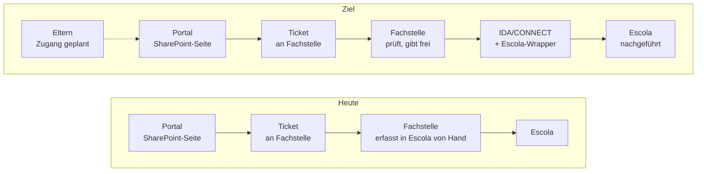
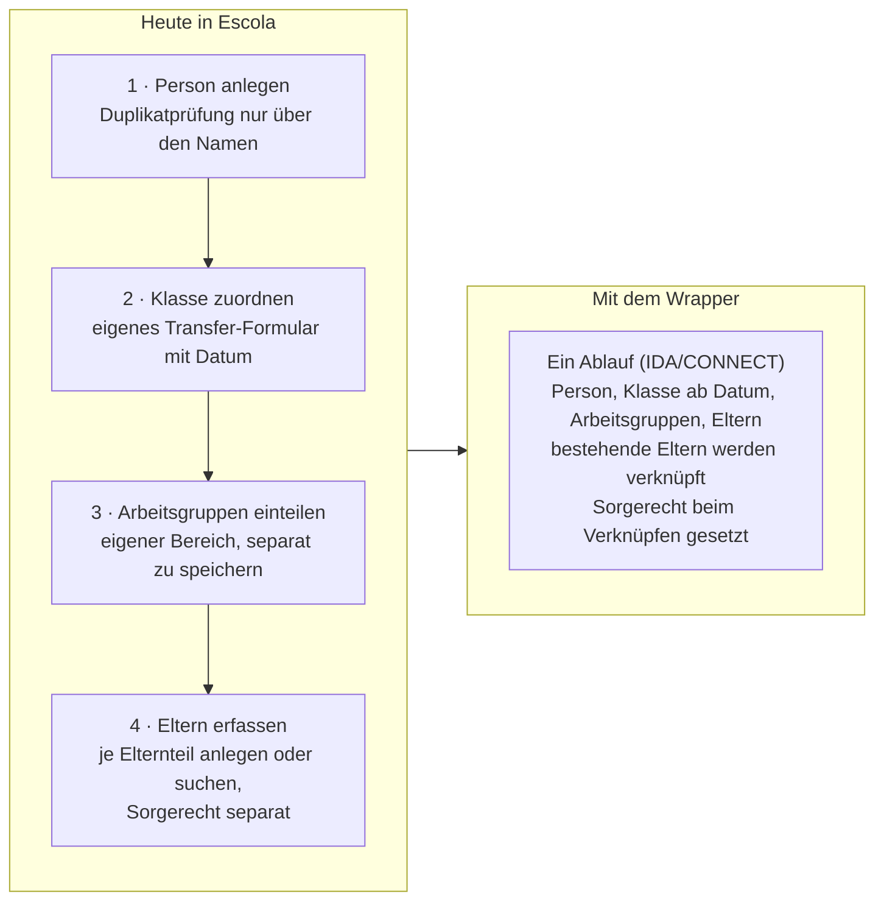

# Escola-Workflows: Aufwand heute und Automatisierung

Stand 15.11.2026 · Sek Bülach · Fassung zum Teilen mit Escola (Original als Dokument in claude.ai, diese Kopie im Repo)

## Zweck

Unser Ziel ist, dass Verwaltungsabläufe über ein Portal ausgelöst und der Escola-Teil danach automatisch erledigt wird. Dieses Dokument zeigt pro Ablauf, wo der Aufwand in Escola heute entsteht, was wir automatisieren und wo Escola selbst nachbessern könnte.

Heute lösen Mitarbeitende die Vorgänge über SharePoint-Seiten der Verwaltung aus (z. B. „Lernende anmelden“, „Kantonale Anstellung“). Daraus entsteht ein Ticket, und die zuständige Fachstelle erledigt den Escola-Teil von Hand. Einiges davon lässt sich auch direkt in Escola erfassen. Für Eltern steht das Portal noch nicht zur Verfügung; Änderungen melden sie heute direkt in Escola.

Weil Escola keine offizielle API hat, haben wir einen Wrapper um die Weboberfläche gebaut. Er arbeitet mit einem persönlichen Login inkl. Zwei-Faktor und nutzt dieselben Aufrufe wie der Browser. Schreiben ist nur mit Freigabe möglich, Löschfunktionen wie „Personen definitiv löschen“ sind bewusst nicht eingebaut.

Die Abläufe WF-01 bis WF-10 haben wir mit den Fachstellen erhoben; nur ein Teil davon ist bereits im Wrapper umgesetzt. Live geprüft sind Login und Lesen, die Schreibabläufe testen wir schrittweise mit Testpersonen und einer Testklasse.

Portal und Ticket bleiben; was sich ändert, ist der Schritt nach der Freigabe durch die Fachstelle.

## Portal-Vorgänge und Stand im Wrapper

Von den Vorgängen auf unseren Portal-Seiten berühren die meisten Escola; die Ein- und Austritte sind im Wrapper bereits abgebildet. „Eingebaut“ heisst: im Wrapper vorhanden, noch nicht alles live getestet.

| Portal-Seite | Vorgang | Ablauf | Escola-Teil | Im Wrapper |
|---|---|---|---|---|
| Verwaltung Lernende | Lernende anmelden | WF-07 | Person, Klasse, Arbeitsgruppen, Eltern | eingebaut |
| Verwaltung Lernende | Lernende abmelden | WF-09 | Austritt, Eltern deaktivieren | eingebaut |
| Verwaltung Lernende | Einteilung | WF-08 | Klasse, Arbeitsgruppen | eingebaut |
| Verwaltung Lernende | Personenangaben | WF-10 | Felder und Adresse | eingebaut (Felder ändern) |
| Verwaltung Lernende | Zahnarzt-/Arztgutschein, Schulbestätigung, Zeugnis-Kopie, Dokument einreichen | – | zu klären (Dokumente) | nein, Dokumente vorbereitet |
| Verwaltung Personelles | Kantonale / kommunale Anstellung | WF-01, WF-03 | Person, Rollen, AHV, Schulmail, Fächer | eingebaut |
| Verwaltung Personelles | Austritt kantonal / kommunal | WF-02, WF-04 | Austritt, Rollen, Nachfolge | eingebaut |
| Verwaltung Personelles | Personalangaben | – | Felder einer Person | eingebaut (Felder ändern) |
| Verwaltung Personelles | Pensum & Anstellung | WF-05, WF-06 | Fächer, Klassenlehrpersonen | zu klären |
| Verwaltung Personelles | Befristete Anstellung (provisorisch, Vikariat) | – | zu klären | nein |
| Verwaltung Personelles | Begleitung, Unfall | – | zu klären | nein |

Eltern können Änderungen bereits direkt in Escola melden, Ein- und Austritte aber nicht. Dafür fehlt heute ein Weg, in Escola wie in unserem Portal.

## Übersicht

Die meisten Abläufe verteilen sich in Escola auf bis zu fünf Bereiche; der Wrapper fasst sie zu einem Aufruf zusammen. „Bereiche“ sind die Escola-Module, die man dafür öffnet, nicht einzelne Klicks.

| Nr | Ablauf | Escola-Bereiche heute | Hauptaufwand | Nachholbedarf Escola |
|---|---|---|---|---|
| WF-01 | Mitarbeiter:in einstellen | Personen (neu), Reiter Personalien/Geschäft, Rollen | AHV und Schulmail von Hand prüfen, Rollen je Schulhaus einzeln | Eindeutigkeit AHV/E-Mail prüfen, Vorlage „neue:r Mitarbeiter:in“ |
| WF-02 | Mitarbeiter:in tritt aus | Personen (Austritt), Rollen | Rollen einzeln entfernen, Datum nur beim Austritt | Austritt mit Rollen-Wechsel ab Datum |
| WF-03 | Neue Lehrperson mit Klasse oder Fachklasse | Personen, Rollen, Einstellungen → Klassen, Lehrpersonen-Fächer, Stundenplan | Fächer pro Klasse einzeln, Rechte in eigener Matrix | Zuteilung Fach × Klasse in einer Maske, Vorlagen (Fach-LP, SoPä) |
| WF-04 | Lehrperson verlässt die Schule | Lehrpersonen-Fächer, Klassen, Stundenplan, Personen | Nachfolge in allen Klassen und Lektionen von Hand | Funktion „Lehrperson ersetzen“ |
| WF-05 | Zusätzliche Klasse (KLP oder Fach) | Einstellungen → Klassen, Lehrpersonen-Fächer | KLP-Formular speichert alle Klassen-Einstellungen mit | KLP getrennt vom Klassenformular |
| WF-06 | Neue Klasse (Wechsel) | wie WF-05, plus Stundenplan | alte Zuteilung lösen, neue setzen, Rechte nachziehen | Wechsel als ein Vorgang, Rechte fürs kommende SJ |
| WF-07 | Schüler:in anmelden mit Eltern | Personen (neu), Klasse zuordnen, Arbeitsgruppen, Bezugspersonen | Eltern je einzeln anlegen oder suchen, Sorgerecht separat | Anmeldung in einem Formular, Duplikatprüfung über Name hinaus |
| WF-08 | Klassenwechsel ab Datum | Personen → Klasse zuordnen, Arbeitsgruppen | Arbeitsgruppen separat nachführen | Arbeitsgruppen beim Wechsel mitführen |
| WF-09 | Schüler:in tritt aus | Personen (Austritt), Bezugspersonen, Arbeitsgruppen | Eltern ohne weitere Kinder von Hand deaktivieren | Eltern beim Austritt automatisch prüfen |
| WF-10 | Schüler:in zieht um | Personen bzw. Bezugsperson | Adresse am richtigen Ort und zum richtigen Datum ändern | Änderungen ab Datum vormerken |

Das Beispiel WF-07 zeigt das Muster aller Abläufe: Die Schritte selbst sind einfach, der Aufwand entsteht durch den Wechsel zwischen den Bereichen.

## Abläufe im Detail

Pro Ablauf: was die Fachstelle nach dem Ticket heute in Escola von Hand erledigt, was der Wrapper übernimmt und was Escola verbessern könnte.

### WF-01 Mitarbeiter:in einstellen

- **Heute:** Person anlegen (Duplikatprüfung nur über Name), Personalien und Geschäft ausfüllen, Rollen je Schulhaus einzeln setzen, Schulmail `vorname.nachname@sekbuelach.ch` von Hand bilden.
- **Wrapper:** prüft AHV-Prüfziffer und ob AHV oder Schulmail schon vergeben sind (aktive und inaktive Personen), legt dann in einem Aufruf an. Bei einer Kollision legt er nichts an und meldet die betroffenen Personen.
- **Vorschlag:** AHV-Nummer und Geschäfts-E-Mail als eindeutige Felder mit Prüfung beim Speichern.

### WF-02 und WF-04 Austritt Mitarbeiter:in / Lehrperson

- **Heute:** Austrittsdatum setzen, dann Fächer, Klassenlehrperson-Plätze und Lektionen in jeder Klasse einzeln an die Nachfolge übergeben, Rollen von Hand entfernen.
- **Wrapper:** zeigt den Einsatz der Lehrperson auf einen Blick und übergibt Fächer, KLP-Plätze und Lektionen in einem Schritt an die Nachfolge. Alle Rollen werden durch „Ausgetreten“ ersetzt.
- **Vorschlag:** eine Funktion „Lehrperson ersetzen“ und ein Rollen-Wechsel, der ab dem Austrittsdatum greift.

### WF-03, WF-05, WF-06 Lehrperson und Klassen

- **Heute:** Fächer werden pro Lehrperson und Klasse einzeln zugeteilt; die Rechte KLR, FP, SpM und Abs stehen in einer eigenen Matrix. Klassenlehrpersonen setzt man im Klassenformular, das beim Speichern alle Klassen-Einstellungen mitschickt.
- **Wrapper:** Vorlagen „Fachlehrperson“, „Klassenlehrperson“ und „SoPä“ setzen Fächer und Rechte zusammen. Für das Klassenformular prüft er nach dem Speichern, dass sich ausser den KLP nichts verändert hat.
- **Vorschlag:** Zuteilung Fach × Klasse in einer Maske mit Vorlagen; Klassenlehrpersonen getrennt vom übrigen Klassenformular speichern.

### WF-07 Schüler:in anmelden mit Eltern

- **Heute:** Person anlegen, Klasse über ein eigenes Transfer-Formular zuordnen, Arbeitsgruppen in einem weiteren Bereich setzen, jede Bezugsperson einzeln anlegen oder suchen und das Sorgerecht separat einstellen.
- **Wrapper:** ein Ablauf für Person, Klasse ab Datum, Arbeitsgruppen und Eltern. Ist ein Elternteil schon erfasst (z. B. über Geschwister), wird verknüpft statt doppelt angelegt.
- **Vorschlag:** eine Anmeldemaske für Kind und Eltern; Duplikatprüfung zusätzlich über Geburtsdatum, Adresse oder E-Mail.

### WF-08 Klassenwechsel ab Datum

- **Heute:** Klassenwechsel mit Transferdatum, Arbeitsgruppen danach separat anpassen.
- **Wrapper:** Wechsel und Arbeitsgruppen in einem Ablauf.
- **Vorschlag:** beim Klassenwechsel anbieten, die Arbeitsgruppen mitzuführen.

### WF-09 Schüler:in tritt aus

- **Heute:** Austrittsdatum setzen; ob die Eltern noch weitere Kinder an der Schule haben, prüft man von Hand und deaktiviert sie dann einzeln.
- **Wrapper:** setzt den Austritt und deaktiviert Eltern ohne weitere aktive Kinder, ausser sie haben eine andere Rolle (z. B. Lehrperson).
- **Vorschlag:** diese Prüfung beim Austritt direkt in Escola anbieten.

### WF-10 Schüler:in zieht um

- **Heute:** Die Adresse steht je nach Fall bei der Schülerin oder bei der Bezugsperson; geändert wird sofort, nicht ab dem Umzugsdatum.
- **Wrapper:** findet die richtige Person über „gleiche Adresse“. Die Ausführung zum Stichtag übernehmen unsere Module IDA bzw. CONNECT.
- **Vorschlag:** Adressänderungen mit Gültigkeitsdatum.

## Was alle Abläufe erschwert

Fünf Eigenheiten tauchen in fast jedem Ablauf auf; sie sind der grösste Hebel für Escola.

| Thema | Beobachtung in Escola | Folge für die Schule |
|---|---|---|
| Stichtage | Datum gibt es beim Klassenwechsel und beim Austritt. Fächer, Rollen, Klassenlehrpersonen, Stundenplan und Adressen gelten sofort. | Änderungen müssen am richtigen Tag von Hand nachgetragen werden. |
| Schuljahr | Das kommende Schuljahr ist ein Zustand der Sitzung: Wer es in der Fächer-Matrix wählt, sieht auch den Stundenplan im kommenden Jahr. | Wer zwischen den Jahren wechselt, arbeitet leicht im falschen Schuljahr. |
| Aktive Klasse und Person | Viele Aktionen wirken auf die zuletzt geöffnete Klasse, Person oder Lehrperson. | Zwei Tabs oder ein Zwischenschritt führen zu Einträgen am falschen Ort. |
| Eindeutigkeit | Die Duplikatprüfung beim Anlegen vergleicht Name und Vorname; nach AHV oder E-Mail lässt sich nicht suchen. | Doppelte Personen, v. a. Eltern von Geschwistern; AHV als Schlüssel für andere Systeme unsicher. |
| Massenbearbeitung | Stundenpläne werden Zelle für Zelle erfasst, Fächer Lehrperson für Lehrperson. | Zum Schuljahresbeginn hoher Zeitaufwand, Fehler fallen spät auf. |

## Wünsche an Escola

Am meisten würde uns eine offizielle Schnittstelle helfen; danach Stichtage und Eindeutigkeit in der Oberfläche.

1. **Offizielle API** für Personen, Klassen, Fächer-Zuteilung und Stundenplan, mit Zugang über einen API-Schlüssel statt eines persönlichen Logins. Dann können wir den Wrapper ablösen.
2. **Änderungen ab Datum** für Fächer, Rollen, Klassenlehrpersonen und Adressen, wie es beim Klassenwechsel schon geht.
3. **Eindeutigkeit** von AHV-Nummer und Geschäfts-E-Mail mit Prüfung beim Speichern und Suche danach.
4. **Sammel- und Vorlagenfunktionen:** Fächer × Klassen in einer Maske, Vorlagen für Fach-LP und SoPä, „Lehrperson ersetzen“.
5. **Anmeldung in einem Schritt:** Kind, Klasse, Arbeitsgruppen und Eltern zusammen erfassen. Ein- und Austritte auch von Eltern melden lassen, wie heute schon Änderungen.
6. **Schuljahr sichtbar machen:** deutlich anzeigen, wenn eine Sitzung im kommenden Schuljahr arbeitet.
7. **Vorankündigung** bei Änderungen am Login oder an den Verwaltungsseiten, solange wir den Wrapper brauchen.

Gerne zeigen wir die Abläufe in einer halben Stunde, auch online.
